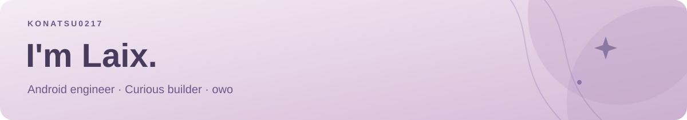

  

  

Text version &amp; links

<h3>A little about me</h3>

Android engineer @ <b>ByteDance</b>, based in <b>Shenzhen</b>. I love coding and building things for the fun of it.

<ul>
  <li>🎓 Master’s in <b>Mechanical Engineering</b> from <b>NUAA</b>.</li>
  <li>🔬 Exploring <b>harness engineering</b> and <b>software architecture</b> in my spare time.</li>
  <li>🌱 New to open source — here to learn and contribute.</li>
  <li>🍺 Into beer, music, and games. A <b>Fender JP</b> keeps me company. 🎸</li>
</ul>

<h3>Beyond code ⚙️</h3>

Mechanical design &amp; machining. Maybe even aircraft engines~? <b>owo</b> 🎹 I arrange music — love <b>jazz fusion</b> &amp; <b>funk</b>.

<h3>Languages &amp; life</h3>

C++ · Python · Kotlin · Rust · TypeScript

<b>Active hours:</b> UTC+8 · 11:30 AM–2:30 AM (+1 day) Coffee OD · VRChat Player

<h3>My little corner of the internet</h3>

<a href="https://laix.icu">laix.icu</a> — <code>.icu</code> reminds me to live well and stay healthy.

Always up for a chat, a collaboration, or a fun idea.

